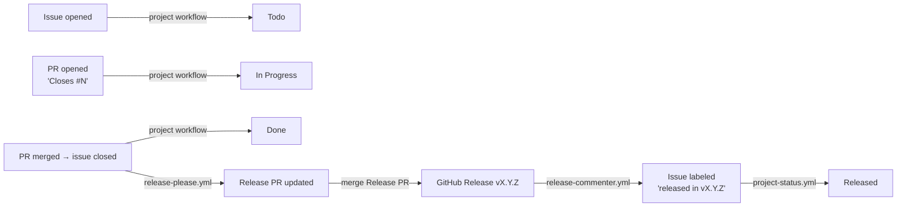

# Release tracking demo

Shows how a GitHub Projects board can tell you, at a glance, which issues are
**merged but not yet released**.



The **Done** column is the list of merged-but-unreleased work. The open
**Release PR** shows the same thing from the code side, with a draft changelog.

## What's in here

| File | Role |
| --- | --- |
| `.github/workflows/release-please.yml` | Keeps a Release PR open; merging it tags and publishes a release |
| `.github/workflows/release-commenter.yml` | On release, labels each shipped issue `released in vX.Y.Z` |
| `.github/workflows/project-status.yml` | Moves released issues to Released (built-in project workflows do the rest) |
| `scripts/set-status.sh` | Sets an issue's Status on the board (user or org projects) |
| `scripts/setup.sh` | Re-runnable bootstrap with the `gh` CLI |
| `scripts/check-app.sh` | Read-only check that `ds-release-bot` is ready for this repo |
| `scripts/demo.sh` | Walks one issue through the lifecycle |
| `release-please-config.json`, `.release-please-manifest.json`, `version.txt`, `CHANGELOG.md` | Release Please state (`simple` release type) |

## Setup

You need the [GitHub CLI](https://cli.github.com) and `jq`.

```bash
gh auth refresh -s project
scripts/check-app.sh developmentseed ds-release-bot release-tracking-demo   # optional, read-only
scripts/setup.sh developmentseed --public --app ds-release-bot
```

`setup.sh` is idempotent: each step checks GitHub's current state, so re-run it
after an interruption and it only does what's still missing.

**Credentials.** The workflows can't use `GITHUB_TOKEN` (it can't touch
Projects, and events it creates don't trigger other workflows). They use:

- **`ds-release-bot`** (preferred), via the org secrets `DS_RELEASE_BOT_ID` and
  `DS_RELEASE_BOT_PRIVATE_KEY`. The App needs read/write on Contents, Issues,
  Pull requests and **Organization → Projects**, must be installed on the repo,
  and both org secrets must be available to the repo. `check-app.sh` checks all
  of this; `setup.sh --app` checks it and points you at anything missing.
- **Otherwise a classic PAT** with `repo` + `project` scopes, stored as the repo
  secret `AUTOMATION_TOKEN` (`setup.sh` without `--app` prompts for it). This is
  the only option for a board owned by a personal account.

Every workflow uses the App when `DS_RELEASE_BOT_ID` is visible and falls back
to `AUTOMATION_TOKEN` otherwise.

**Finish in the browser** (the API can't do these):
- Project settings → **Status** field → add an option named `Released`.
- Switch the view to **Board** layout.
- Project → **Workflows**, enable:
  - **Auto-add to project**: filter `repo:<org>/release-tracking-demo is:issue`.
  - **Item added to project** → set Status to `Todo`.
  - **Pull request linked to issue** → set Status to `In Progress`.
  - **Item closed** → set Status to `Done`.

## Run the demo

```bash
scripts/demo.sh "Add a greeting"          # feat → minor bump
scripts/demo.sh "Fix the greeting" fix     # fix  → patch bump, same release
gh pr merge <release-pr-number> --squash   # ship it
```

Watch the board after each pause. After the Release PR merges, give Actions
a minute: release → label → status is three workflow runs in a row.

## Why it's wired this way (gotchas)

- **Never `GITHUB_TOKEN`.** Events created with the default `GITHUB_TOKEN`
  don't trigger other workflows. If Release Please used it, the release
  wouldn't trigger `release-commenter.yml`. If the commenter used it, the label
  wouldn't trigger the `released` job.
- **Conventional commits matter.** Release Please only cuts a release for
  `feat:`, `fix:` and similar commit types. The repo is set to squash-merge
  with the PR title as the commit title, so the **PR title** must be
  conventional (`feat: …`). A `chore:`-only main produces no Release PR.
  Consider adding a PR-title lint check for real repos.
- **`Closes #N` goes in the PR description**, not a comment.
- **Baseline release.** `github-release-commenter` intentionally skips a
  repo's first release, which is why setup creates `v0.1.0` up front.
- **Single-package only.** The commenter compares against the previous
  release, which doesn't work well with Release Please monorepo per-component
  tags or out-of-order patch releases.
- **Built-in workflows vs. Actions.** The project's built-in workflows add
  issues and set Todo, In Progress and Done without any token. None of them
  can react to a label, so `project-status.yml` does only the Released move.
  "Item closed" also marks issues closed as *not planned* as Done.
- **Pin actions.** Third-party actions are referenced by tag for readability;
  pin them to commit SHAs for production use.
